<p align="center">
  <picture>
    <source media="(prefers-color-scheme: dark)" srcset="docs/brand/octolan-logo-horizontal-white.svg">
    
  </picture>
</p>

# OctoLAN

**Portable network discovery, mapping and posture assessment for MSP field techs.**

Plug a laptop into a customer's network, run one file, and get a live map of the network, a full device inventory, traffic and layer-2 health monitoring, and a scored security-posture report you can hand to the customer. No installer, no runtime, no agents, no cloud.

```
octolan            # opens the live dashboard in your browser
octolan scan       # or run the whole assessment from the terminal
```

One self-contained binary per platform: Windows, macOS and Linux (x86-64 and ARM), plus OpenWrt/embedded Linux (MIPS, ARM). Nothing else to install.

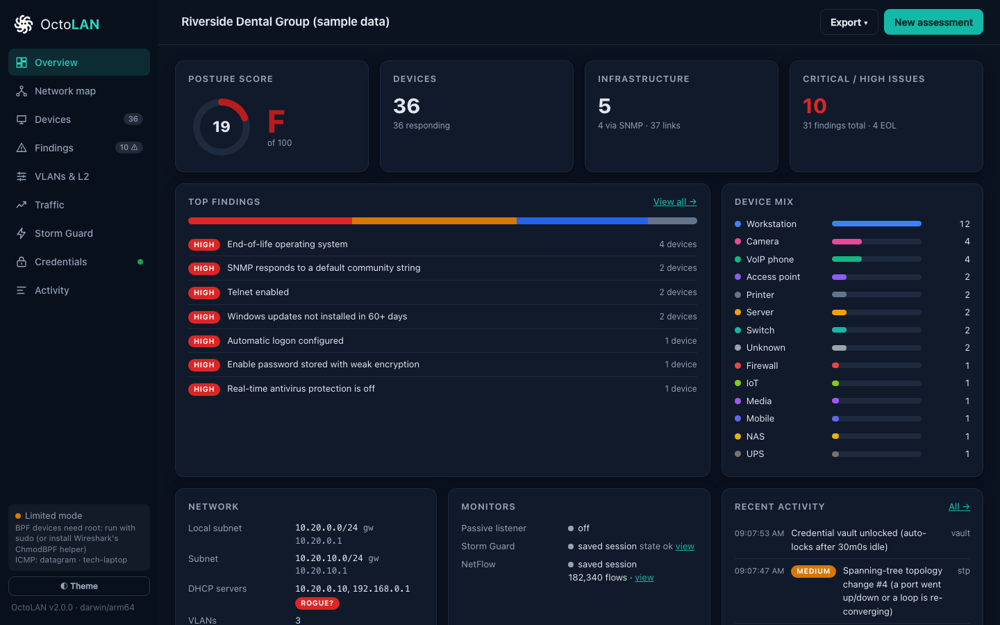

**📄 [Download an example report (PDF)](docs/sample-report.pdf)**, the deliverable you hand the customer at the end of a visit.

> The dashboard and report screenshots use **Riverside Dental Group**, a fictional sample site (see [Sample data](#sample-data)). The terminal screenshots are real runs, with hostnames and IP addresses replaced by generic ones.

---

## Screenshots

### In the terminal

`octolan scan` runs the full assessment without a browser and writes the report and session file at the end. (This run was unprivileged, so it used ping, TCP, DNS and mDNS. MAC addresses fill in when it runs with `sudo` or Npcap.)

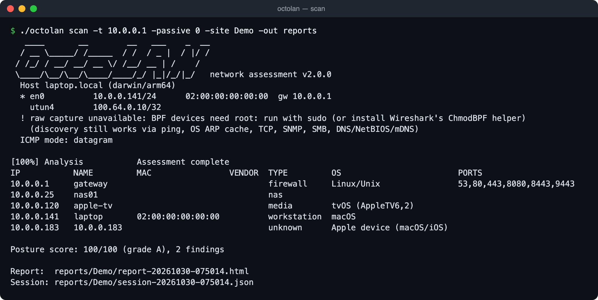

<details>
<summary>More terminal screenshots: <code>octolan help</code> and the NetFlow collector</summary>

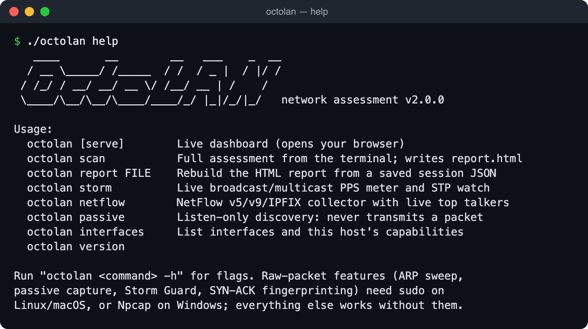

`octolan netflow` collects NetFlow v5/v9/IPFIX and prints top talkers and applications every few seconds:

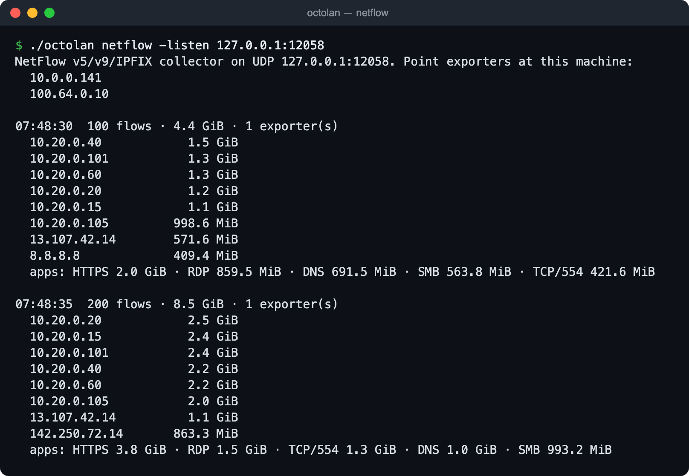

</details>

### The dashboard

| Network map | Device inventory |
|---|---|
| 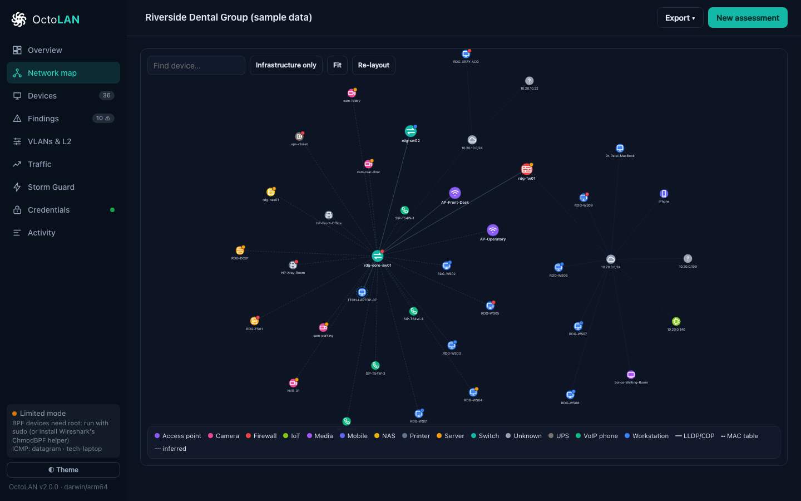 | 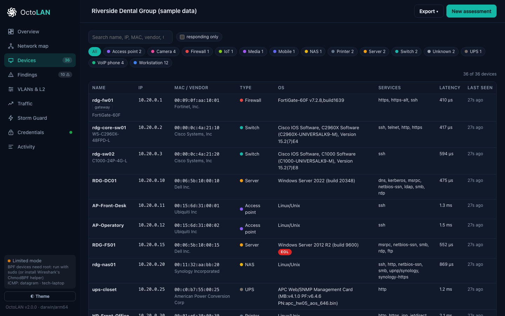 |
| **Findings with remediation** | **Storm Guard** |
| 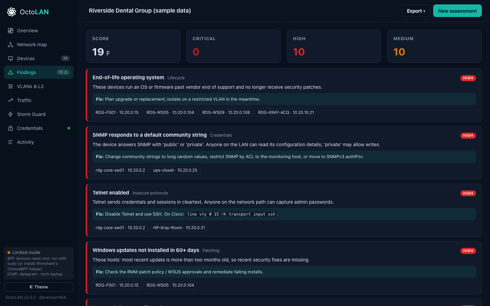 | 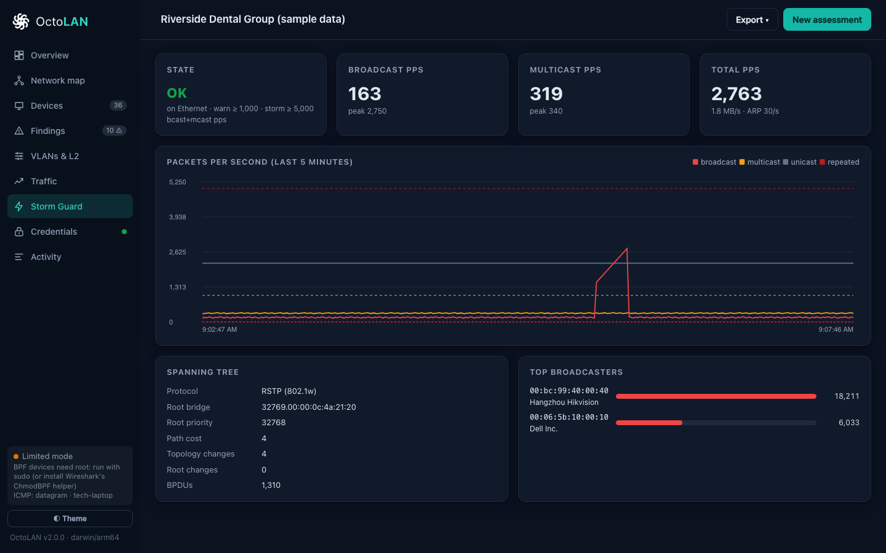 |
| **Traffic (NetFlow / IPFIX)** | |
| 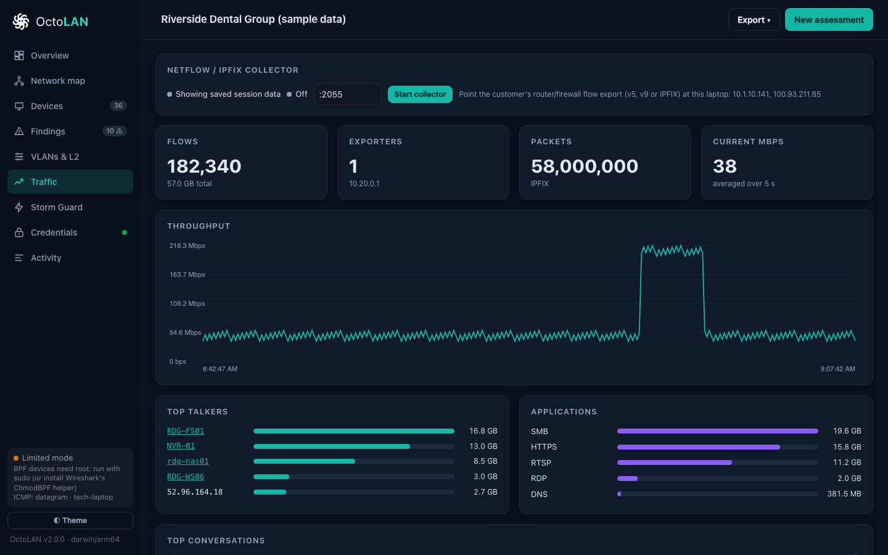 | |

### The customer report

**Export → Open report** produces one self-contained HTML file. Print it to PDF from any browser. [See the full example PDF](docs/sample-report.pdf) (14 pages).

| Executive summary | Topology |
|---|---|
| [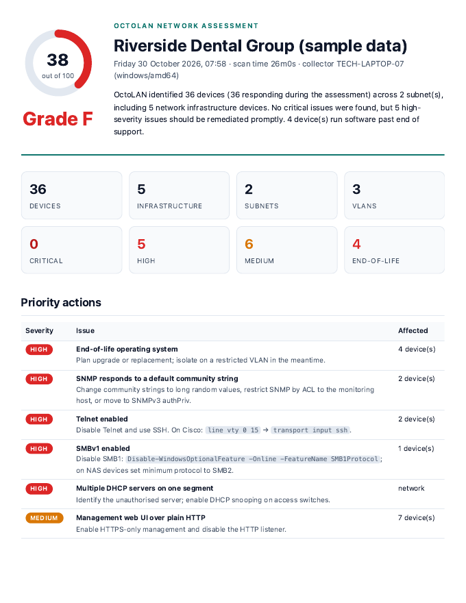](docs/sample-report.pdf) | [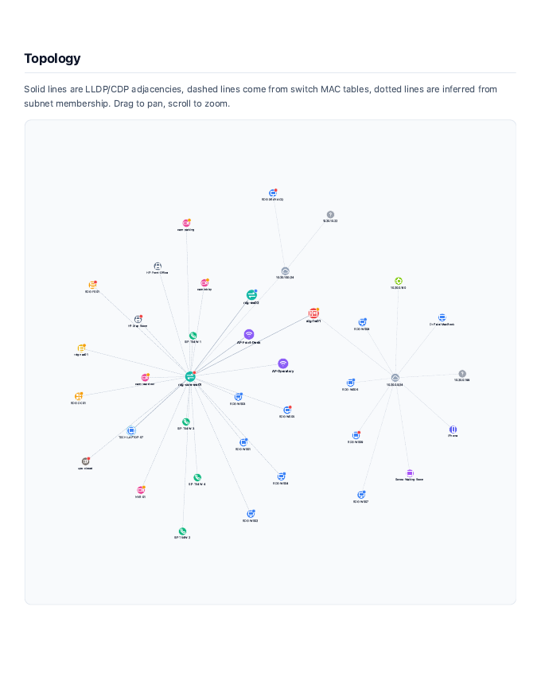](docs/sample-report.pdf) |

The report covers: posture score and grade, an executive summary, priority actions, network overview (subnets, DHCP servers, VLANs, spanning tree, broadcast levels), an interactive topology map, every finding with its remediation and affected devices, the full device inventory, NetFlow top talkers and applications, and the methodology (what ran and what was skipped).

---

## What it does

| | Capability | How |
|---|---|---|
| 1 | **Layer-2 ARP discovery** | Crafts raw ARP who-has frames (AF_PACKET / BPF / Npcap) to find every live MAC on the segment, even hosts that firewall ICMP and TCP. Falls back to the Windows `SendARP` API or the OS ARP cache when raw access isn't available. |
| 2 | **ICMP sweep** | Rate-limited echo sweep with microsecond round-trip timing and TTL capture (raw sockets, unprivileged datagram ICMP, or the Windows ICMP API, whichever the host allows). |
| 3 | **OS fingerprinting** | Initial TTL, TCP window, DF bit and MSS from the SYN-ACKs of the service scan; Windows build/version from the anonymous SMB/NTLM handshake; SNMP sysDescr; service banners; Bonjour model IDs; DHCP vendor class. Flags end-of-life systems. |
| 4 | **LLDP/CDP and VLANs** | Hears LLDP/CDP from the switch port it's plugged into (switch name, port, native VLAN); polls LLDP-MIB and CDP tables over SNMP and **crawls neighbor management addresses**; learns VLANs from Q-BRIDGE / Cisco VTP, LLDP 802.1 TLVs and 802.1Q tags on the wire. |
| 5 | **Zero-footprint passive listener** | DHCP hostnames, vendor classes and **rogue DHCP servers**; mDNS/Bonjour; SSDP/UPnP; any host that talks on the segment. *Zero-footprint mode* never transmits a single packet. |
| 6 | **NetFlow v5 / v9 / IPFIX collector** | UDP 2055 listener with template handling; top talkers, applications, protocol mix, conversations and throughput over time. |
| 7 | **Storm Guard** | Promiscuous per-second broadcast / multicast / unicast / ARP metering, repeated-frame (loop) detection, top broadcasters, spanning-tree root bridge, root changes and topology-change floods. |
| 8 | **Runs on routers and edge devices** | The same Go code cross-compiles to static Linux binaries for MIPS/ARM routers (OpenWrt) and servers. No C toolchain or separate C engine needed. |

Plus the inventory and mapping you'd expect from a network management platform:

- **SNMP v1/v2c/v3 inventory**: system info, interfaces (speed, status, errors, traffic), model/serial/firmware (ENTITY-MIB), switch MAC tables, router ARP tables (finds hosts on *other* VLANs), VLAN names.
- **Topology map** built from LLDP/CDP adjacencies, then switch forwarding tables (which edge port each device is on), then subnet clouds for everything else. Drag, zoom, search, infrastructure-only view.
- **Device classification**: router, firewall, switch, AP, server, workstation, hypervisor, NAS, printer, VoIP phone, camera, mobile, media, IoT, UPS. Uses SNMP, ports, banners, OUI vendor (embedded IEEE registry), mDNS and DHCP evidence. Techs can correct the type, name and notes in the UI.
- **Name resolution**: reverse DNS, NetBIOS node status, unicast mDNS, SMB/NTLM computer and domain names.
- **Security posture checks**, scored 0–100 with a letter grade:
  Telnet/FTP, Cisco Smart Install, unauthenticated Docker/Redis/Elasticsearch/MongoDB, VNC, RDP on workstations, TR-069, PPTP, plain-HTTP management UIs, default SNMP communities, SNMPv1/v2c, SMBv1, SMB signing not required, end-of-life OS, old OpenSSH, expired/expiring/self-signed certificates, legacy TLS, UPnP on the gateway, rogue DHCP, duplicate IPs, broadcast storms, STP instability/root changes/default priority, flat networks, IoT not segmented, interface errors, high latency, long uptime (unpatched).
  *Scoring:* each finding costs points by severity, more affected devices cost more, and penalties have diminishing returns (so even a very neglected network stays above 0 and progress after remediation is visible). The worst issue caps the grade: any critical finding means a D at best, any high finding a C at best.
- **Reports**: a single self-contained HTML report (interactive map, executive summary, priority actions, findings with remediation, full inventory, methodology). Print to PDF straight from the browser. Also CSV (devices, findings) and JSON session files.

## Quick start

1. Download the binary for your laptop from [Releases](../../releases) (or build it, below).
2. Plug into the customer network (ideally a normal access port in the main VLAN).
3. Run it:

| OS | Full capability | Without admin rights |
|---|---|---|
| **macOS** | `sudo ./octolan-darwin-universal` | `./octolan-darwin-universal` |
| **Linux** | `sudo ./octolan-linux-amd64` | `./octolan-linux-amd64` |
| **Windows** | Install free [Npcap](https://npcap.com), then run `octolan-windows-amd64.exe` | Just run it |

The dashboard opens at `http://127.0.0.1:8484`. Enter the customer name, click **New assessment**, and watch the map fill in. When it's done, **Export → Open report** and print to PDF.

> **First run on macOS:** downloaded binaries are quarantined by Gatekeeper. Run `xattr -d com.apple.quarantine ./octolan-darwin-universal` once (or right-click → Open).
> **Windows SmartScreen** may warn about an unsigned executable: *More info → Run anyway*.

### What raw capture adds

Without admin/root (or Npcap on Windows) OctoLAN still discovers devices via ping, the OS ARP cache, TCP, SNMP, SMB, DNS, NetBIOS and mDNS. Raw packet access adds:
ARP sweeps (finds firewalled hosts), passive DHCP/LLDP/CDP/STP/VLAN listening, Storm Guard, and SYN-ACK stack fingerprinting. The sidebar shows which mode you're in and why.

On Linux you can grant raw access once instead of using sudo:
`sudo setcap cap_net_raw,cap_net_admin+ep ./octolan-linux-amd64`

## Command line

```
octolan [serve]          Live dashboard (default)
  -site "Acme Dental"     customer / site name
  -iface en0              interface (default: the one with the default route)
  -listen 0.0.0.0:8484    share the dashboard with teammates (prints a tokenized URL)
  -netflow :2055          start the NetFlow collector too
  -load session.json      reopen a saved assessment
  -scan                   start an assessment immediately
  -collector tech-laptop  name shown for this computer in the dashboard and reports
                          (default: its hostname; use it to keep a personal machine name private)

octolan scan             Full assessment in the terminal; writes report + session
  -t 10.0.0.0/24 -t 10.0.5.1-50   targets (default: local subnet)
  -c public -c s3cr3t             SNMP communities (default: public, private)
  -v3 user:SHA:authpass:AES:privpass
  -ports default|top|none|22,80,8000-8100
  -passive 180                    seconds of passive listening (DHCP/LLDP/STP)
  -zero-footprint                 listen only; never transmit
  -rate 400                       sweep packets/second
  -out ./reports
  -collector tech-laptop          name shown for this computer in the report
  -vault                          use the site's credential vault (prompts for the passphrase)

octolan vault init|add|list|rm|passwd -site "Acme"   Manage a customer's credential vault
octolan report session.json      Rebuild the HTML report from a saved session
octolan storm [-warn 1000 -crit 5000]   Live broadcast-storm / STP meter
octolan netflow [-listen :2055]  NetFlow/IPFIX collector with live top talkers
octolan passive [-seconds 300]   Listen-only discovery
octolan interfaces               Interfaces and what this host can do
```

Sessions and reports are saved under `~/OctoLAN/<site>/`. SNMP communities and v3 passwords typed into a scan are held in memory only and are never written to session files or reports. To keep credentials between visits, use the [credential vault](#credential-vault).

Reopening a saved session (`octolan -load session.json`) shows it exactly as it was captured. Live monitoring of the network you're on now only starts when you run a new assessment, so reviewing a customer's results back at the office won't mix in the office network.

## Credential vault

When a customer hands over admin or switch credentials, store them in the site's **encrypted vault** and OctoLAN logs in during the scan to collect much more:

| Credential | Used for | What it adds |
|---|---|---|
| **Windows admin** (domain or local) | WinRM (5985, NTLM-encrypted; or 5986) | OS build and patch level, last update, Defender and other AV status, BitLocker, firewall profiles, local administrators, installed software, disks, pending reboot, auto-logon, RDP NLA, hardware model and serial |
| **SSH** (password or key, optional Cisco enable secret) | Switches, routers, firewalls, Linux and NAS | **Config backup** (Cisco IOS/NX-OS, Arista, Aruba, Juniper, FortiGate, MikroTik) with a hardening audit; model, serial, firmware and uptime; Linux distribution, kernel, CPU, memory and disk |
| **SNMP** (v2c community or v3 user) | SNMP polling | Saved so you don't retype them each visit |

New findings come from this data: Windows updates older than 60 days, real-time antivirus off, BitLocker off, firewall off, automatic logon, too many local admins, RDP without NLA, plaintext/weak enable passwords, Telnet on VTY lines, SNMP write communities, no syslog/NTP/AAA, and more.

| Credentials page | Windows host details | Switch with config backup |
|---|---|---|
| 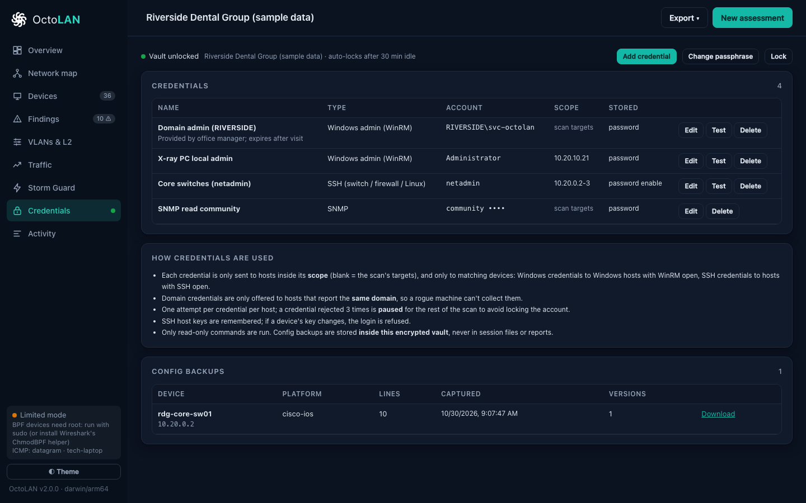 | 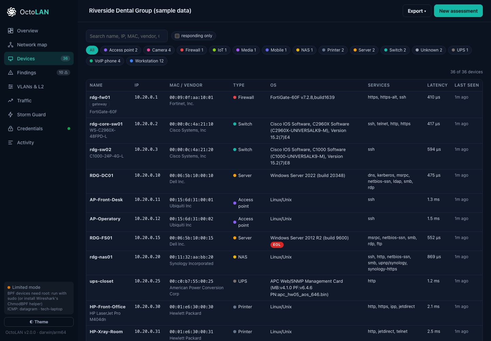 |  |

**How it's protected**

- **One vault per customer**: `~/OctoLAN/<site>/credentials.octovault`. Changing the site in the dashboard locks the open vault, so one customer's credentials can't be used at the next site.
- **Encryption**: the passphrase (minimum 10 characters) is stretched with **Argon2id** (64 MiB, 3 passes) and the vault is sealed with **XChaCha20-Poly1305**. The file header is authenticated too, so tampering or weakened parameters are rejected. The file is readable only by your user. The passphrase is never stored; if it's lost, the vault can't be opened.
- **Secrets never leave the vault in readable form**: the dashboard can save credentials but never reads secrets back, and they never appear in session files, reports or logs. The vault auto-locks after 30 minutes idle, and repeated wrong passphrases are slowed down.
- **Config backups** contain secrets of their own (password hashes, SNMP communities), so they're stored inside the encrypted vault (the newest five versions per device), not in sessions or reports.

**How credentials are used during a scan**

- **Scope**: a credential is only sent to hosts in its scope. Blank means the scan's targets; otherwise list CIDRs, ranges or IPs.
- **Matching devices only**: Windows credentials go to hosts with Windows evidence and WinRM open; SSH credentials go to hosts with SSH open.
- **Same domain only**: domain credentials are only offered to hosts that report the same domain. This stops a rogue machine on the LAN from collecting a domain admin's NTLM login.
- **Lockout protection**: each credential is tried once per host, and is paused for the rest of the scan after 3 rejections, so a wrong or expired password can't lock the customer's account.
- **SSH host keys are remembered**: if a device presents a different key on a later visit, the login is refused and flagged as possible interception.
- **Read-only**: only read-only commands are run (`show …`, `Get-…`, `uname`). Nothing is changed on customer devices.

**Using it**

- **Dashboard**: open **Credentials**, create the vault (or unlock it), add credentials, and use **Test** to try one against a host. Then start an assessment with **Use saved credentials** ticked.
- **Terminal**:

  ```
  octolan vault init -site "Acme Dental"
  octolan vault add  -site "Acme Dental"      # prompts; secrets aren't echoed
  octolan scan -site "Acme Dental" -vault     # prompts for the vault passphrase
  ```

WinRM is enabled by default on Windows Server. On workstations it's usually enabled by group policy in managed environments; hosts without it are still assessed without logging in.

## Using it on site: tips

- **Ask for credentials**: a domain admin login (ideally a dedicated account created for the visit and disabled afterwards) plus the switch login turns the assessment from "what's on the network" into "how well is it maintained". Store them in the [credential vault](#credential-vault) and have the customer rotate them afterwards.
- **Get the most from SNMP**: ask the customer for the read-only community (or v3 user). Switch MAC tables and LLDP/CDP neighbors are what turn a device list into an accurate map.
- **NetFlow**: point the firewall's flow export at the laptop's IP, UDP 2055, and leave the dashboard open for a while.
- **Mirror/SPAN port**: plugging into a mirror port gives Storm Guard and the passive listener visibility of the whole switch.
- **Routed subnets**: add other VLANs' CIDRs as targets. Routers' ARP tables (via SNMP) also reveal hosts there.
- **Sensitive environments** (medical, OT/ICS): use *Zero-footprint mode* first, then decide on active scanning.
- **Share with a teammate**: `octolan -listen 0.0.0.0:8484` prints a URL with an access token. Without `-listen`, the dashboard is only reachable from the laptop itself.

Only scan networks you are authorized to assess.

## Building

Requires Go 1.27+. No cgo, no C libraries.

```
go build ./cmd/octolan        # this machine
./scripts/build.sh           # all platforms → ./dist (with SHA256SUMS)
go test -race ./...
```

### Sample data

The screenshots and [example report](docs/sample-report.pdf) come from a fictional dental practice generated by `tools/docsdemo`. The devices are invented, but they go through OctoLAN's real classifier, topology builder and posture checks. To regenerate:

```
go run ./tools/docsdemo docs/sample/session.json      # add -vault DIR for a sample vault (passphrase "sample passphrase")
go run ./cmd/octolan report docs/sample/session.json -o docs/sample/report.html
go run ./cmd/octolan -load docs/sample/session.json   # browse it in the dashboard
```

Print `docs/sample/report.html` to PDF from any Chromium browser to rebuild `docs/sample-report.pdf`.

To refresh the embedded MAC-vendor table:

```
curl -fsSLo manuf https://www.wireshark.org/download/automated/data/manuf
go run ./tools/genoui manuf internal/oui/oui.txt.gz
```

### Layout

```
cmd/octolan          CLI entry point
internal/capture    raw Ethernet I/O: AF_PACKET (Linux), BPF (macOS/BSD), Npcap loaded at runtime (Windows)
internal/discovery  ARP, ICMP, TCP + banners, SYN-ACK fingerprinting, TLS, SMB/NTLM, names, SNMP, classifier
internal/passive    listen-only discovery (DHCP, LLDP, CDP, mDNS, SSDP, 802.1Q)
internal/storm      Storm Guard (PPS meter, loop detection, STP)
internal/netflow    NetFlow v5/v9/IPFIX collector
internal/topology   map builder
internal/assess     posture checks and scoring
internal/vault      encrypted per-site credential vault (Argon2id + XChaCha20-Poly1305)
internal/collect    credentialed checks: WinRM (Windows) and SSH (network gear, Linux), config audit
internal/engine     scan pipeline and monitors
internal/report     HTML/CSV reports
internal/web        dashboard API (JSON + server-sent events)
internal/ui/static  dashboard front end (vanilla JS, embedded)
tools/genoui        rebuilds the embedded MAC-vendor table
tools/docsdemo      generates the fictional sample site used in docs/
docs/               screenshots, example report (PDF) and sample session
```

## Logo

The OctoLAN mark is an octopus seen from above, its eight arms swirling out from one body like links off a core switch. It is a single solid black or white shape with the eyes cut out, so it works on any background. The dashboard uses it in the sidebar and as the browser tab icon.

All files are in [`docs/brand/`](docs/brand/):

| File | Use |
|---|---|
| `octolan-mark.svg` | Mark alone, takes the surrounding text color (`currentColor`) |
| `octolan-mark-black.svg`, `octolan-mark-white.svg` | Mark alone, fixed color |
| `octolan-logo-horizontal.svg` (`-black`, `-white`) | Mark with the name beside it |
| `octolan-logo-stacked.svg` | Mark with the name underneath |
| `favicon.svg` | Browser icon with heavier arms for 16px; turns white in dark browser themes |
| `favicon.ico`, `favicon-16/32/48.png` | Icons for older browsers and tools |
| `apple-touch-icon-180.png` | iOS home screen icon |
| `octolan-mark-512.png` | Large transparent PNG |

The name is set in IBM Plex Mono SemiBold and converted to outlines, so no font is needed.
